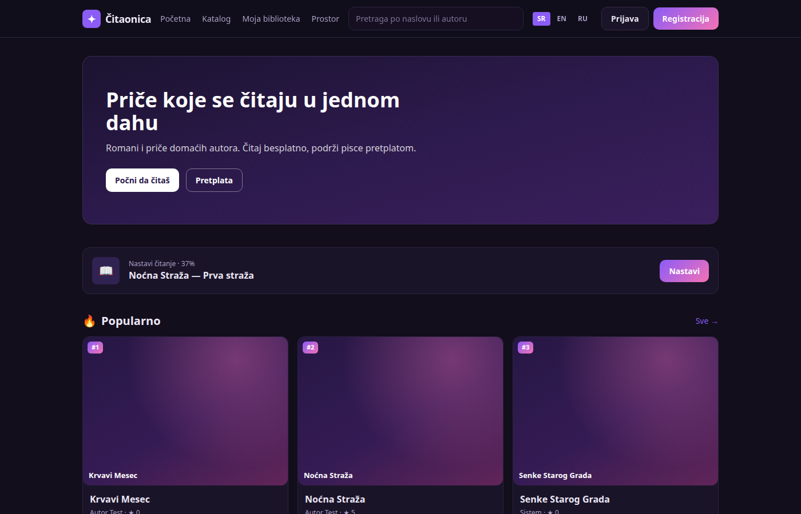
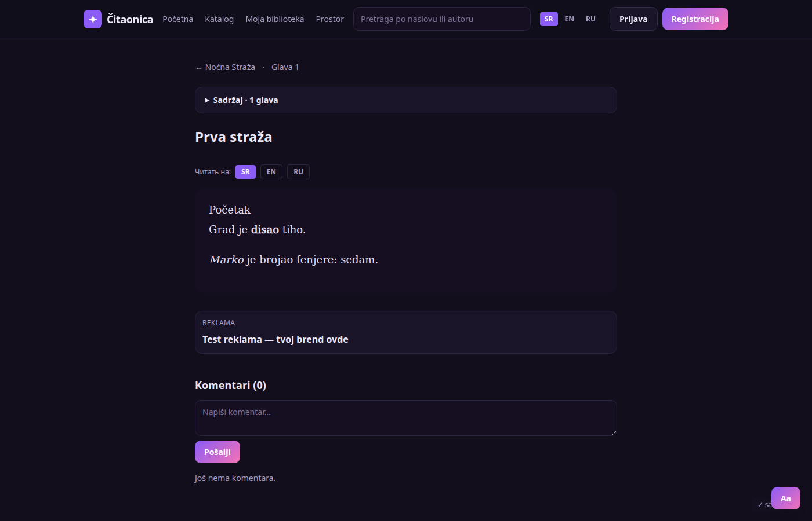
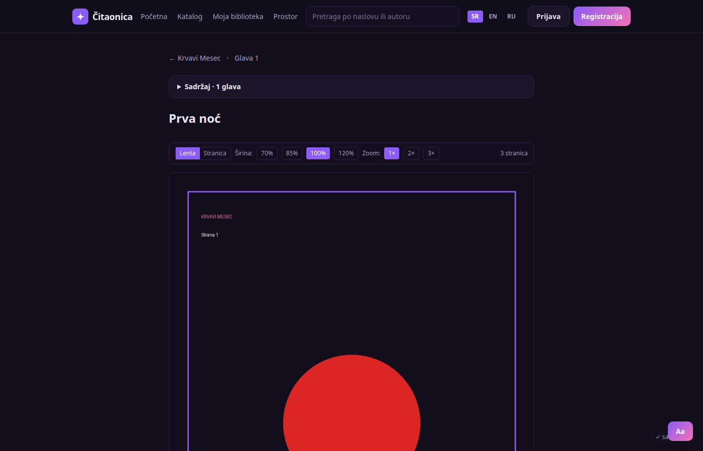
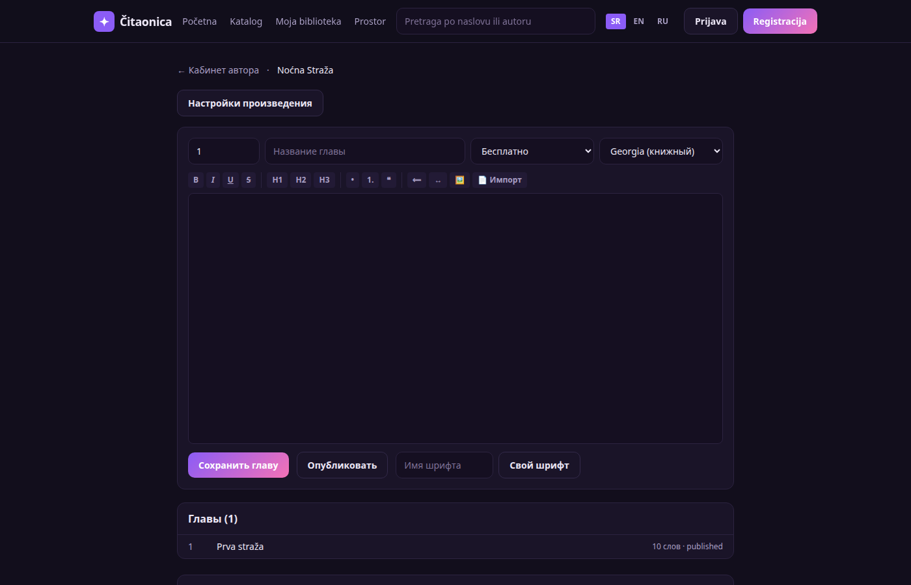

# Платформа чтения с ИИ-переводом

Полноценная платформа для публикации и чтения книг и комиксов: каталог, читалка,
кабинет автора, подписки, админка и **ИИ-перевод глав на локальной модели** (Ollama, qwen2.5)
с глоссарием терминов и кэшем по хэшу.

## Возможности

- **Каталог**: поиск, жанры, разделение «романы / комиксы», сортировка по новизне, оценке, читаемости
- **Произведение**: обложка, жанры, звёздный рейтинг, библиотека, комментарии, оглавление
- **Читалка**: прогресс, настройки (шрифт, размер, интервал, темы: тёмная/светлая/сепия), paywall
- **ИИ-перевод** SR · EN · RU: промпт с ролями и правилами, глоссарий, кэш sha256;
  глава ≈ 6 секунд, повтор мгновенно, нулевая стоимость инференса
- **Комиксы**: пачечная загрузка страниц, перетаскивание порядка, режимы «лента»/«страница»,
  зум 1–3× (пинч и двойное касание), ленивая загрузка
- **Кабинет автора**: Tiptap-редактор, импорт .docx/.md/.txt, иллюстрации, свои шрифты,
  обложка, глоссарий, публикация через проверку, статистика
- **Подписки**: тарифы, ручная оплата и Stripe Checkout/вебхуки (включаются ключами)
- **Служебное**: подтверждение почты, модерация комментариев, админ-панель, SEO, 404,
  ограничение частоты запросов, health-эндпоинт, бэкапы, Docker Compose + PostgreSQL

## Стек

Next.js 15 · TypeScript · Tailwind · Tiptap · SQLite (`node:sqlite`) / PostgreSQL ·
Ollama (qwen2.5) · mammoth · marked · DOMPurify · vitest · Docker

## Скриншоты






## Запуск

```bash
npm install
npm run dev          # http://127.0.0.1:3020
```

Без `DATABASE_URL` используется SQLite (`data/reader.db`), миграции применяются автоматически.

## Проверки

```bash
npm run test         # 33 автотеста (vitest)
npm run check        # тесты + production-сборка
npm run backup       # дамп базы + архив загрузок
```

## Продакшен

```bash
cp .env.example .env   # SITE_URL, JWT_SECRET, ADMIN_TOKEN, DATABASE_URL, OLLAMA_URL
docker compose up -d --build
```

Перевод требует локальную модель: `ollama pull qwen2.5:7b` и `OLLAMA_URL`.
